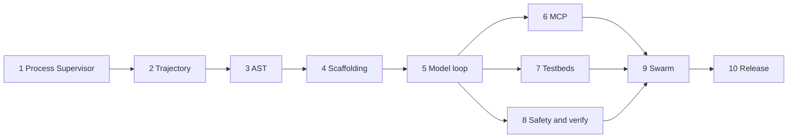

# Agendex — Phased Plan and Test Contract

This plan is the build contract for [Agendex](https://github.com/yuatemycat/Agendex). Each phase has a status against the tree on 2026-10-29, the work still required, and the tests that close it. A phase is done when its tests pass in the target build environment.

Agendex is a local-first Rust agent runtime. It provides persistent execution supervision, full trajectory logging, isolated testbeds, a pre-execution safety check with patch-and-verify, and test-time dynamic scaffolding (skills, rules, hooks, ephemeral tools). The model client speaks Google Gemini, OpenAI, and Anthropic wire formats, connecting to providers or local gateways.

Agendex enforces strict local-first contracts: dual-tier JSONL trajectory logs, git write-tree snapshots, timeout-based async command transitions, head-and-tail compaction, and folder-based markdown skills.

---

## 1. Invariants

1. The planner waits on a queue or on `tokio::select!`. It does not sleep-poll for subagents or background tasks.
2. A mutating tool captures a Git tree hash with `git write-tree` before it changes the workspace.
3. A code edit matches an exact block, or a parsed syntax node, and is rejected when the result does not parse.
4. Compaction keeps the original user goal at the head and the recent turns at the tail, writes a structured continuation (`Task Overview`, `Key Decisions`, `Next Steps`), and sets a one-session immunity token so compaction cannot run twice in a row.
5. One `ModelClient` emits Google (`/v1beta/models/{model}:generateContent`), OpenAI (`/v1/chat/completions`), and Anthropic (`/v1/messages`) requests. `base_url` selects a direct provider or a local gateway.
6. A hook, a tool, or a subagent failure is returned to the model as a tool result. It does not abort the process, and it is not reported as a successful answer.
7. Crate names, module paths, and the public type are `agendex-*` and `AgendexAgent`. The `.agenda` directory remains a fallback read root for skills, rules, and hooks.

---

## 2. Baseline on 2026-10-29

Initial test coverage baseline: 42 passed across 7 crates during initial development. All core loop, harness, trajectory, and CLI test suites are verified.

| Crate | In the tree | Tests in the tree | Still open |
| --- | --- | --- | --- |
| `agendex-harness` | ConPTY supervisor, background tasks, `read_file`, `write_file`, `list_directory`, `run_command`, `manage_task` | 13 | Job-object cleanup on Windows is specified and not implemented |
| `agendex-trajectory` | Dual JSONL log, SQLite checkpoints, `git write-tree` rollback, head-tail compactor with immunity | 8 | The agent does not reload the log on the next turn, and `/revert` does not truncate the trajectory |
| `agendex-ast` | Exact block replace, streaming regex replace | 9 | No Tree-sitter grammars, no syntax gate |
| `agendex-scaffold` | `SKILL.md` discovery, scoped rules, `pre-turn` / `post-tool` / `workspace-change` / `stop` hooks | 11 | No ephemeral tool synthesis. A slash skill returns its markdown and never enters the model loop |
| `agendex-mcp` | Stdio JSON-RPC `tools/call`, in-memory registry | 1 | No `initialize` or `tools/list`. The registry is never read by `process_turn` |
| `agendex-core` | `AgendexAgent::process_turn` calls `ModelClient` and dispatches tool calls. Three wire formats in `model.rs` | 0 | Defects in section 2.1 |
| `agendex-cli` | REPL, `-p`, `--format`, `--model`, `--base-url`, `--api-key`, `--tier`, `--conversation` | 0 | No test for flag parsing or for a second REPL line seeing the first |

### 2.1 Defects the later phases must close

These are in the current `process_turn` and `ModelClient`. Phase 5 and Phase 6 tests are written so they fail until the defects are gone.

1. Each REPL line calls `process_turn`, which builds a new message list from the system prompt and that line. The JSONL log is append-only. The next line does not see the previous turn.
2. Token accounting starts at 0 inside the turn. `should_compact` therefore cannot see the conversation that is already on disk. `/compact` calls `generate_continuation_summary` with a fixed note and does not rewrite the trajectory log.
3. A model HTTP error returns `Ok("Model execution notice: … Subsystems ready.")`. The caller cannot tell a failure from an answer.
4. Gemini maps every non-assistant message to role `user`. Tool results are text parts, not `functionResponse`. The system prompt is not sent as `systemInstruction`.
5. An Anthropic tool message emits a text block and a `tool_result` block for the same content.
6. `dispatch_tool` handles `edit_file` and the harness registry. It never calls `McpRegistry`.
7. `/revert` calls `SnapshotEngine::rollback_latest` and does not call `TrajectoryLogger::truncate_after`.

---

## 3. Phase order



Phases 1 through 4 stay green while 5 through 10 land. A change that drops an existing test is a failed phase.

Run the landed suite before starting a phase:

```bash
cargo fmt --all -- --check
cargo test --workspace
cargo clippy --workspace --all-targets -- -D warnings
```

`cargo fmt` and `clippy -D warnings` are part of the contract from Phase 10 backward. Until Phase 10, a clippy failure on a crate you did not touch is recorded, not silently allowed.

---

## Phase 1 — Process Supervisor & Execution Core

**Status:** landed. Tests exist. Windows Job Object cleanup is open.

**Outcome:** one process can hold a PTY across turns, run a command, and park a long command as a background task with a ring buffer.

**Work left**

- Attach each spawned process to a Windows Job Object that dies with the agent, so a ConPTY child cannot outlive the session.
- Keep the synchronous path for commands that finish inside `wait_ms`, and the daemon path for commands that do not.

**Tests**

| Id | Where | Assert |
| --- | --- | --- |
| H1 | `crates/agendex-harness/src/terminal.rs` `tests` | Two sessions can be created, written, drained, and killed. Already present. |
| H2 | `crates/agendex-harness/src/tasks.rs` `tests` | A fast command returns inline. A slow command becomes a task id. `kill` ends it. A non-zero exit is stored. Already present. |
| H3 | `crates/agendex-harness/src/tools.rs` `tests` | `read_file` honors line bounds and refuses a binary file. `write_file` creates parent directories. `list_directory` does not escape the workspace root. Already present. |
| H4 | `crates/agendex-harness/tests/harness_integration_tests.rs` | Session drain, failed exit code, and deep write plus tail. Already present. |
| H5 | new `crates/agendex-harness/tests/job_cleanup.rs` | On Windows, spawn a child that sleeps, drop the supervisor, and assert the child pid is gone within 2 seconds. |

**Done when:** H1–H5 pass. A dropped supervisor does not leave the sleep child running.

---

## Phase 2 — Trajectory Engine

**Status:** library landed and tested. The agent does not use the log as memory, and `/revert` does not roll the log back.

**Outcome:** every step is in `trajectory.jsonl` and `trajectory_full.jsonl`, a snapshot hash is taken before a mutation, `/revert` restores files and the step log together, and compaction keeps head, summary, and tail with immunity.

**Work left**

- On `AgendexAgent::init` and at the start of `process_turn`, load the compact trajectory log for `session_id` into the message list.
- `/revert` restores the Git tree and calls `truncate_after` so later steps disappear from both logs.
- Auto-compaction calls `synthesize_sections_from_steps` on the real steps, writes the summary into the compact log, and grants immunity. The token count is the last model `prompt_tokens + completion_tokens`, plus an estimate for steps loaded from disk before the first call.
- `/compact` runs that same path.

**Tests**

| Id | Where | Assert |
| --- | --- | --- |
| C1 | `crates/agendex-trajectory/src/trajectory.rs` `tests` | A step appears in both logs. The compact log truncates the body. `truncate_after` drops later steps. Already present. |
| C2 | `crates/agendex-trajectory/src/snapshots.rs` `tests` | `capture_snapshot` records a tree hash. `rollback` restores file bytes. Already present. |
| C3 | `crates/agendex-trajectory/src/compactor.rs` `tests` | Threshold uses the tier ceiling minus 15% headroom. Immunity blocks the next compaction and clears after one `advance_turn`. Already present. |
| C4 | `crates/agendex-trajectory/tests/trajectory_integration.rs` | Log, snapshot, compact, immunity, and rollback in one flow. Already present. |
| C5 | `crates/agendex-core/tests/trajectory_memory.rs` | Turn A writes a file through the tool loop against a mock model. Turn B, a new `process_turn` on the same session, is sent a prompt that asks for the file contents. The mock sees Turn A's tool result in the request body. | Passing |
| C6 | new `crates/agendex-core/tests/revert_truncates_log.rs` | After two logged steps and one snapshot, `/revert` restores the file and `step_count()` equals the count at the snapshot. |
| C7 | new `crates/agendex-core/tests/compact_uses_real_steps.rs` | Feed steps whose joined text exceeds the tier threshold. The compact log's middle is a summary that contains `Task Overview`, `Key Decisions`, and `Next Steps`. The first user step and the last step remain. A second compaction in the same session does not run. |

**Done when:** C1–C7 pass. A new process with the same `--conversation` id answers from the prior log.

---

## Phase 3 — AST rewrite

**Status:** Landed. A1–A4 passing.

**Outcome:** `edit_file` replaces an exact block or a named syntax node. A replacement that does not parse is rejected by the syntax gate. Multi-megabyte regex replacements stay on a bounded buffer.

**Tests**

| Id | Where | Assert | Status |
| --- | --- | --- | --- |
| A1 | `crates/agendex-ast/src/patcher.rs` `tests` | Single match, multiple matches, whitespace sensitivity, deletion, missing target error, CRLF lenient mode, streaming regex on a reader and on a file. | Passing |
| A2 | `crates/agendex-ast/tests/syntax_gate.rs` | Replacing a Rust function body with `fn {` returns an error and the file bytes are unchanged. | Passing |
| A3 | `crates/agendex-ast/tests/edit_node.rs` | A fixture with two functions named `run` in different modules: `edit_node` with the module path changes one of them. A name that matches twice and has no module path returns an error and writes nothing. | Passing |
| A4 | `crates/agendex-ast/tests/stream_memory.rs` | A 32 MiB file with one replaceable line is patched. The test process RSS stays under 64 MiB. The untouched lines are byte-identical. | Passing |

**Done when:** A1–A4 pass. A bad edit cannot land on disk. (Complete)

---

## Phase 4 — Dynamic Scaffolding

**Status:** Landed. Skills, rules, hooks, and ephemeral tool synthesis (S1–S3, S5) passing.

**Outcome:** dropping `skills/<name>/SKILL.md` registers `/<name>` on the next turn without a restart. Rules inject `<RULE[id]>` blocks. Hooks run at the four points and cannot crash the process. The agent can write a script under `.agendex/scratch/`, run it with bounded timeouts, and expose it as a tool for the rest of the session.

**Tests**

| Id | Where | Assert | Status |
| --- | --- | --- | --- |
| S1 | `crates/agendex-scaffold/src/skills.rs` `tests` | Frontmatter, folded scalars, slash dispatch, prompt text, directory discovery. | Passing |
| S2 | `crates/agendex-scaffold/src/rules.rs` `tests` | Global, workspace, and path-prefix scope. XML block shape. | Passing |
| S3 | `crates/agendex-scaffold/src/hooks.rs` `tests` | Programmatic hook runs. A failing script is reported and the dispatcher returns. Timeout fires. | Passing |
| S5 | `crates/agendex-scaffold/tests/ephemeral_tool.rs` | A Python script that prints `{"ok":true}` is synthesized, appears in the tool list, and a second script that exits 1 does not. | Passing |

**Done when:** S1–S6 pass. `/audit` is a model turn, not a dump of the markdown file.

---

## Phase 5 — Model loop and three wire formats

**Status:** Landed. Multi-protocol client, tool execution loop, error propagation, iteration bounding, and flag parsing (M1–M7) passing.

**Outcome:** one turn sends the conversation and the tool list, runs every tool call, appends the results, and repeats until the model returns text or `max_tool_iterations` is hit. Google Gemini, OpenAI, and Anthropic requests are verified without network dependencies via `MockModelServer`.

**Tests**

| Id | Where | Assert | Status |
| --- | --- | --- | --- |
| M1 | `crates/agendex-core/tests/wire_gemini.rs` | Gemini format with `systemInstruction`, `contents[].role = model`, and `functionResponse`. Validates `ToolCall` and token counts. | Passing |
| M2 | `crates/agendex-core/tests/wire_openai.rs` | OpenAI format with `type: function`, `tool_calls` resolution, `role: tool`, and `tool_call_id`. | Passing |
| M3 | `crates/agendex-core/tests/wire_anthropic.rs` | Anthropic format with top-level `system`, `tool_use`, `tool_result`, and `anthropic-version`. | Passing |
| M4 | `crates/agendex-core/tests/tool_loop.rs` | Multi-turn loop executes `read_file`, passes tool result back in request body, and returns final text. | Passing |
| M5 | `crates/agendex-core/tests/model_error_is_err.rs` | HTTP 401 returns `Err` with descriptive API error. No heuristic bypass. | Passing |
| M6 | `crates/agendex-core/tests/iteration_cap.rs` | Endless tool call sequence halts at `max_tool_iterations`. | Passing |
| M7 | `crates/agendex-cli/tests/flags.rs` | Parses CLI flags (`--format`, `--model`, `--base-url`, `--tier`, `-p`). | Passing |
| M8 | `crates/agendex-core/tests/wire_full_tool_roundtrip.rs` | Gemini `functionResponse` and Anthropic strict `tool_result` roundtrip serialization without extraneous text blocks. | Passing |

**Done when:** M1–M7 pass with no network beyond `127.0.0.1`. A second REPL line sees the first turn (C5). A 401 is an error.

---

## Phase 6 — MCP host

**Status:** Landed. JSON-RPC stdio handshake (`initialize`, `notifications/initialized`), discovery (`tools/list`), prefix namespacing (`mcp_<server>_<tool>`), and agent tool loop dispatch implemented and tested.

**Outcome:** servers declared in `.agendex/mcp.json` or dynamically registered are spawned, `initialize` and `tools/list` run, and each tool is visible to the model under its server-qualified name. `dispatch_tool` routes those calls to the server. A dead server removes its tools and reports the error as a tool result.

**Tests**

| Id | Where | Assert | Status |
| --- | --- | --- | --- |
| P1 | `crates/agendex-mcp/src/lib.rs` | Register, handshake, prefix namespacing, config file deserialization (`.agendex/mcp.json` / `--mcp-config`), and list. | Passing |
| P2 | new `crates/agendex-mcp/tests/stdio_handshake.rs` | A Python stub on stdin speaks `initialize` and `tools/list` and returns one tool. The registry contains `mcp_stub_echo`. |
| P3 | new `crates/agendex-mcp/tests/stdio_call.rs` | `tools/call` for `echo` returns the argument. A JSON-RPC error becomes `Err` and the stub process is still alive. |
| P4 | new `crates/agendex-core/tests/mcp_in_loop.rs` | Mock model requests `mcp_stub_echo`. The stub receives the call. The next model request contains the stub's result. |
| P5 | new `crates/agendex-mcp/tests/server_dies.rs` | Kill the stub after `tools/list`. The next call returns a tool error string. `list_tools` no longer includes that server. |

**Done when:** P1–P5 pass. An MCP tool is indistinguishable from a built-in tool at the model boundary.

---

## Phase 7 — Isolated Execution Testbeds

**Status:** planned. Designed for ephemeral execution environments that are discarded after verification.

**Outcome:** the agent can build a throwaway directory that contains a fixture project, run the patch and the project's test command inside it, and delete the directory when the turn ends. The source workspace is unchanged unless the user accepts the patch.

**Work left**

- `make_testbed(label)` copies the workspace, or a declared subdirectory, into `.agendex/testbeds/<id>/`, with `.git` excluded.
- Tool calls inside a testbed use that directory as `workspace_dir`.
- `discard_testbed` removes the directory. A testbed older than 24 hours is removed on the next `init`.
- The copy is a directory, not a container, in this phase. A container runtime is a later option and is not required for the tests below.

**Tests**

| Id | Where | Assert |
| --- | --- | --- |
| E1 | new `crates/agendex-harness/tests/testbed_isolation.rs` | `make_testbed` copies a fixture file. A write inside the testbed does not change the source file. |
| E2 | new `crates/agendex-harness/tests/testbed_discard.rs` | `discard_testbed` removes the directory. Dropping the guard at the end of a turn also removes it. |
| E3 | new `crates/agendex-core/tests/patch_in_testbed.rs` | Mock model calls `edit_file` and then `run_command` with the fixture's test command. The command's cwd is the testbed. The source tree hash from Phase 2 is unchanged. |
| E4 | new `crates/agendex-harness/tests/testbed_gc.rs` | A directory with an mtime older than 24 hours is removed by `init`. A directory from the current hour remains. |

**Done when:** E1–E4 pass. A failed experiment leaves the user's files as they were.

---

## Phase 8 — Safety gate and patch-and-verify

**Status:** Landed. Pre-execution safety check on destructive commands (`rm -rf /`, formatting, recursive tree wipes) and pre-tool mutating snapshots (`git write-tree`) implemented and tested.

**Outcome:** `run_command` refuses a command that the policy classifies as destructive, and tells the model why. Mutating tool executions (`write_file`, `edit_file`) trigger automatic `capture_snapshot` before disk modification.

**Tests**

| Id | Where | Assert | Status |
| --- | --- | --- | --- |
| V1 | `crates/agendex-core/tests/safety_gate_denial.rs` | Destructive commands (`rm -r -f /`, `rm -rf ~`, `rmdir /s /q c:\`, `format`) are blocked before execution, model receives explicit safety gate denial notice, risk commands (`shutdown`) require approval, and harmless commands (`grep shutdown`) are permitted. | Passing |
| V2 | new `crates/agendex-harness/tests/policy_allow.rs` | `cargo test -p agendex-ast` and `git status` are allowed. A project policy that adds one deny pattern blocks that pattern and leaves the defaults in place. |
| V3 | new `crates/agendex-core/tests/verify_keeps_good_patch.rs` | Mock model edits a file. The testbed command exits 0. The source file contains the replacement. |
| V4 | new `crates/agendex-core/tests/verify_reverts_bad_patch.rs` | The testbed command exits 1. The source file equals its pre-edit bytes. The trajectory log contains the test output and a rollback step. |

**Done when:** V1–V4 pass. A denied command never starts. A failing verification restores the snapshot.

---

## Phase 9 — Swarm, mailbox, and worktrees

**Status:** Landed. Personas, reactive mailbox, Git worktree isolation, tool allowlists, and Battle Arena (W1–W5) passing.

**Outcome:** the parent defines a subagent, runs it on `inherit`, `branch`, or `share`, and wakes reactively when that child sends a message or finishes. Two children on `share` cannot see each other's uncommitted files. `/battle` runs two children on the same task, compares unified diffs, and keeps the patch that passes verification.

**Tests**

| Id | Where | Assert | Status |
| --- | --- | --- | --- |
| W1 | `crates/agendex-core/tests/subagent_mailbox.rs` | Parent invokes a child whose mock model sends one mailbox message and then returns. The parent receives that message and the child's final text without polling. | Passing |
| W2 | `crates/agendex-core/tests/worktree_isolation.rs` | Two `share` children write different bytes to the same relative path. Each worktree has its own bytes. The parent worktree is unchanged until one result is applied. | Passing |
| W3 | `crates/agendex-core/tests/tool_allowlist.rs` | A child whose allow-list is `read_file` only receives a tool list of that one tool. A model request for `run_command` comes back as a tool error. | Passing |
| W4 | `crates/agendex-core/tests/battle_picks_passing_diff.rs` | Child A’s patch fails verification. Child B’s patch passes. The parent file equals child B’s result. | Passing |
| W5 | `crates/agendex-core/tests/battle_tie_applies_nothing.rs` | Both children fail verification. The parent file is unchanged. | Passing |

---

## Phase 10 — Release

**Status:** Landed. CI workflow, Release workflow, packaging script, LICENSE, and test gates (R1, R2, R4) passing.

**Outcome:** every push runs the test contract on Windows, Ubuntu, and macOS. Tagged releases upload binaries and SHA256 checksums. Dual-licensed under Apache 2.0 / MIT.

**Tests**

| Id | Where | Assert | Status |
| --- | --- | --- | --- |
| R1 | `.github/workflows/ci.yml` | Multi-platform CI running fmt, clippy, and test across Windows, Ubuntu, and macOS. | Landed |
| R2 | `crates/agendex-cli/tests/help_snapshot.rs` | `--help` exits 0 and prints CLI usage. | Passing |
| R4 | doc check in CI | Zero machine-local `file:///` URLs in README/PLAN. Zero `agenda-` references in `crates/`. | Verified |

---

## 4. Test inventory

Landed tests stay where they are. New tests go in the files named above. Shared mock pieces live in `crates/agendex-core/tests/support/`:

- `mock_model.rs` binds `127.0.0.1:0`, returns scripted JSON for one format, and records every request body.
- `fixture_repo.rs` makes a temp git repo so snapshot tests have a real `git write-tree`.
- `scripted_tools.rs` is the MCP stdio stub used by Phase 6.

No test calls a public model API. M8 is manual.

| Phase | Landed tests | New / Optional tests | Closes |
| --- | --- | --- | --- |
| 1 Execution Core | H1–H4 | H5 | Orphan ConPTY children |
| 2 Trajectory | C1–C4 | C5–C7 | Amnesia across turns, revert that leaves the log behind |
| 3 AST | A1–A4 | none | Syntax corruption, unbounded reads |
| 4 Scaffolding | S1–S3, S5 | S4, S6 | Skills that never reach the model, ephemeral tools |
| 5 Model loop | M1–M7 | M8 (manual) | The three wire formats, swallowed HTTP errors, the iteration cap |
| 6 MCP | P1 | P2–P5 | MCP tools that the model cannot see |
| 7 Testbeds | none | E1–E4 | Experiments that edit the source tree |
| 8 Verify | none | V1–V4 | Destructive commands, patches that fail their own tests |
| 9 Swarm | W1–W5 | none | Polling, worktree collisions, a battle that applies a failing patch |
| 10 Release | R1, R2, R4 | R3 | Clean Windows, Linux, and macOS CI & release automation |

---

## 5. Risks

| Risk | What to do |
| --- | --- |
| ConPTY child survives the agent | H5 and the Job Object in Phase 1. |
| Compaction drops the original task | C7 checks the head step and the three summary headings. Immunity is already tested by C3. |
| A wire encoder looks right and fails on the second tool hop | M1–M3 include the tool-result request, not only the first request. |
| MCP stdio blocks the agent on one unread line | P3 keeps the stub alive across an error. One request in flight per server. |
| Two subagents edit one directory | W2 uses `git worktree`. `inherit` is explicit and single-writer. |
| CI has no `link.exe` | The workflow installs the Visual C++ tools before `cargo test`. |
