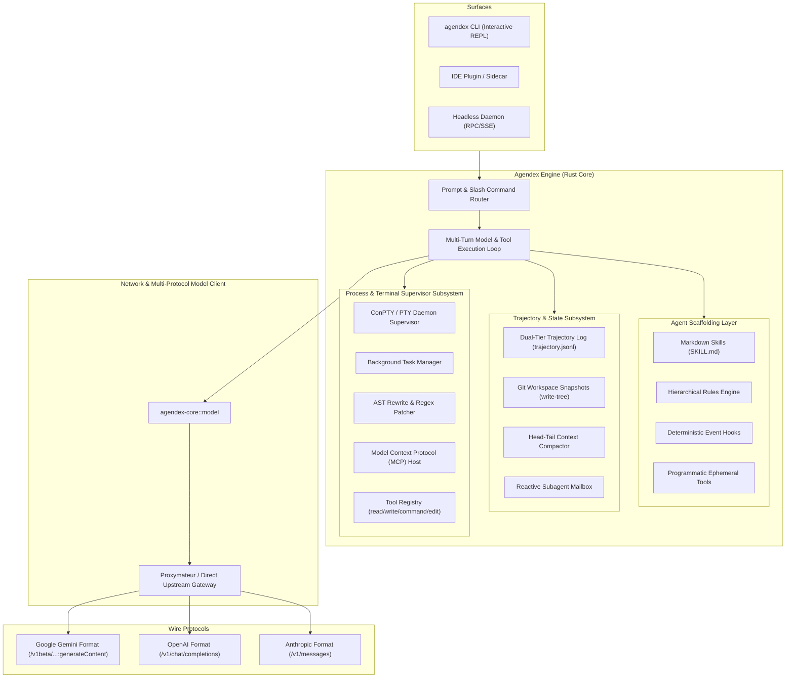

# Agendex

**Agendex** is an open-source, local-first autonomous agent harness, execution supervisor, and trajectory state engine.

Built as a high-performance local agent runtime, Agendex provides an un-opinionated engine for AI coding assistants and autonomous swarms with persistent execution supervision, full trajectory logging, and dynamic self-scaffolding without proprietary cloud daemon dependencies.

---

## 1. Architectural Overview

Agendex separates agent logic into three decoupled layers: **Execution** (local OS interactions and persistent PTYs), **Trajectory State** (trajectory logging, Git workspace snapshotting, time-travel rollbacks, and intelligent compaction), and **Dynamic Scaffolding** (runtime tool generation, Markdown skills, and lifecycle hooks).



---

## 2. Core Pillars & Capabilities

### A. Multi-Protocol Model Client (`agendex-core::model`)
Agendex is protocol-agnostic and natively translates model requests and tool schemas across three primary wire formats:
- **Google Gemini Format**: Generates content via `/v1beta/models/{model}:generateContent` with native `functionDeclarations` and parses `functionCall` blocks.
- **OpenAI Format**: Standard `/v1/chat/completions` with JSON schema `tools` array and `tool_calls` parameter resolution.
- **Anthropic Claude Format**: Calls `/v1/messages` with native `tools`, parsing `tool_use` blocks and returning `tool_result` content.
- **Upstream Flexibility**: Point Agendex directly to Google AI Studio, OpenAI, Anthropic, or an aggregation gateway (such as [Proxymateur](https://github.com/yuatemycat/Proxymateur)) for automatic quota pooling.

### B. The Trajectory & State Subsystem (`agendex-trajectory`)
- **Dual-Tier Audit Logging**: Compact trajectory log (`trajectory.jsonl`) for lightweight active context feeding paired with lossless audit logs (`trajectory_full.jsonl`).
- **Workspace Time-Travel & Rollbacks (`snapshot-revert`)**: Automatically records Git tree-hash snapshots before mutating tool operations, enabling atomic undo of agent mistakes.
- **Head-Tail Context Compactor**: Automatically triggers when conversation tokens breach model-specific ceilings (32k / 64k / 80k / 128k / 200k / 256k / 840k / 1M / 2M). Retains initial user objectives (Head) and active execution contexts (Tail) while synthesizing the intermediate trajectory into structured resumption anchors with post-compaction immunity.
- **Artifact Engine**: Isolated sandbox storage for markdown reports, diff carousels, and visual diagrams.

### C. The Process & Terminal Supervisor (`agendex-harness`)
- **Persistent Shell Terminals (ConPTY / PTY)**: Keeps long-lived terminal sessions, background servers, and shell environments alive across multi-turn workflows.
- **Background Task Supervisor**: Commands exceeding execution thresholds automatically transition into managed asynchronous tasks with real-time log streaming and stdin pipes.
- **AST Component Rewrite Engine (`agendex-ast`)**: Drop-in block replacements with whitespace preservation and streaming regex substitution for large files.
- **Model Context Protocol Host (`agendex-mcp`)**: Stdio JSON-RPC client capable of lazy schema loading and bridging external MCP servers into the agent's tool catalog.

### D. The Dynamic Scaffolding Layer (`agendex-scaffold`)
- **Markdown-Driven Skills (`SKILL.md`)**: Drop-in folder-based skill definitions that map directly to custom slash commands (e.g., `/swarm`, `/plan`, `/benchmark`).
- **Scoped Rule Hierarchies**: Contextual markdown rules matched by working directory, branch, or workspace triggers.
- **Deterministic Lifecycle Hooks**: User-defined interception points (`pre-turn`, `post-tool`, `workspace-change`, `stop`) for absolute verification gates.
- **Programmatic Tool Synthesis**: On-the-fly generation, compilation, and execution of ephemeral tools in `scratch/` when static toolkits are insufficient.

---

## 3. Technology Stack

- **Core Runtime**: Rust 2021 (`tokio`, `reqwest` with rustls, `serde`, `rusqlite`).
- **Terminal Virtualization**: `portable-pty` / Windows ConPTY API.
- **AST Analysis & Validation**: Streaming regex and balanced delimiter syntax validator.
- **File Matching & Search**: `ignore`, `globset`, `regex`.
- **Gateway Interoperability**: Direct high-speed integration with local gateways or native provider endpoints.

---

## 4. Repository Layout

```
Agendex/
├── Cargo.toml                  # Workspace manifest
├── README.md                   # Project overview & architectural guide
├── PLAN.md                     # Phased delivery roadmap
├── scripts/                    # Release and build automation
└── crates/
    ├── agendex-cli/            # Interactive REPL & CLI argument parser
    ├── agendex-core/           # Central orchestration loop, model client & router
    ├── agendex-harness/        # Process supervisor: ConPTY, async tasks, base tools
    ├── agendex-trajectory/     # Trajectory engine, snapshotting, compaction
    ├── agendex-ast/            # Exact block drop-in & streaming regex patcher
    ├── agendex-mcp/            # Model Context Protocol client & registry
    └── agendex-scaffold/       # Dynamic skills, rules, hooks, ephemeral tools
```

---

## 5. Quick CLI Usage Contract

### Starting an Interactive Shell

```bash
# Run interactive REPL with default Google Gemini format
agendex

# Run interactive REPL with OpenAI format
agendex --format openai --model gpt-4o --base-url https://api.openai.com --api-key $OPENAI_API_KEY

# Run interactive REPL with Anthropic format
agendex --format anthropic --model claude-3-5-sonnet-20241022 --base-url https://api.anthropic.com --api-key $ANTHROPIC_API_KEY

# Route through local Proxymateur gateway
agendex --format gemini --base-url http://127.0.0.1:8045 --api-key my-proxy-key
```

### Running Autonomous Non-Interactive Turns

```bash
agendex -p "Audit the authentication crate and patch security regressions" --tier 128k
```

### In-Session Commands

```text
/help           # Show all available commands and active skills
/compact        # Trigger manual Head-Tail context compaction
/revert         # Time-travel rollback to previous snapshot
exit            # Exit the interactive session
```

---

## 6. Live Benchmark: Autonomous Bug Discovery & Self-Correction

The following is an end-to-end run showing Agendex pointed at a Rust crate with a failing unit test. The agent autonomously inspected the repository, ran the test suite, diagnosed the off-by-one bug, patched the source file, and verified the fix.

| Metric | Measurement |
| :--- | :--- |
| **Model** | `nvidia/nemotron-3.5-lightning-30b-a3b` via NVIDIA NIM (OpenAI wire format) |
| **Agendex** | `main` |
| **Fixture** | Rust crate (`src/lib.rs`, `src/config.rs`, `src/net.rs`) with 1 failing unit test |
| **Performance** | 11 seconds wall time, 6 model turns, 9 tool calls |

### The Command

```bash
agendex --format openai \
  --base-url https://integrate.api.nvidia.com/v1 \
  --model nvidia/nemotron-3.5-lightning-30b-a3b \
  --api-key "$NVIDIA_API_KEY" -y \
  -p "The test suite fails (cargo test). Find the bug, fix it, and run the tests to confirm they pass."
```

### The Bug

```rust
/// Sum of integers 1..=n
pub fn sum_to(n: u32) -> u32 {
    (1..n).sum()
}

#[cfg(test)]
mod tests {
    use super::*;
    #[test]
    fn sums() {
        assert_eq!(sum_to(4), 10);
    }
}
```

### Autonomous Execution Trajectory

1. **`list_directory`**: Scans the workspace structure.
2. **`read_file`**: Batches reads across `Cargo.toml`, `src/lib.rs`, `src/net.rs`, and `src/config.rs`.
3. **`run_command`**: Runs `cargo test` (exit code 101, assertion failure `left == 6, right == 10`).
4. **Diagnosis**: Identifies that `(1..n)` is an exclusive range summing to 6 instead of 10.
5. **`edit_file`**: Surgically rewrites `(1..n).sum()` to `(1..=n).sum()` in `src/lib.rs`.
6. **`run_command`**: Verifies with `cargo test` (exit code 0, all tests pass).

```diff
-    (1..n).sum()
+    (1..=n).sum()
```

### Resumed Turn: Memory Across CLI Invocations

When resumed with `agendex --conversation <session-id>`:
> *"Without using any tools: what file did you change in the previous turn, and what exactly did you change?"*

Agendex answers directly from its reloaded trajectory memory:
> *"In the previous turn I changed `src/lib.rs`. The exact edit was replacing the range `(1..n)` with `(1..=n)` on the line that computes the sum."*

Every action is persisted in `.git/agendex/logs/<session-id>/trajectory.jsonl` (compact) and `trajectory_full.jsonl` (lossless audit log), with workspace time-travel snapshots stored in `.git/agendex/snapshots.json`.

---

## 7. License

Apache 2.0 / MIT Dual License.
